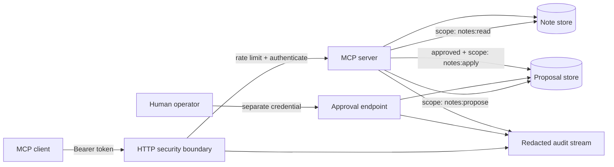

# Secure MCP Starter

> A deliberately small TypeScript reference server that makes authentication,
> authorization, approval, auditability, and safe defaults visible.

[](https://modelcontextprotocol.io/)
[](https://www.typescriptlang.org/)
[](SECURITY.md)
[](LICENSE)

Most MCP demos start with a calculator tool. This starter begins one step later:
what happens when a tool can change data?

It implements a tiny notes domain so the security boundaries remain easy to inspect.
Reads are scope-gated. Changes are proposed first, approved through a separate HTTP
control plane, and applied exactly once. Every decision produces a structured audit
event with secrets removed.

## Security properties

| Control           | Implementation                                                      |
| ----------------- | ------------------------------------------------------------------- |
| Authentication    | Separate reader, operator, and approver credentials                 |
| Authorization     | Scope checks inside every tool handler                              |
| Human approval    | Out-of-band approval endpoint unavailable to the MCP agent          |
| Replay protection | Approved proposals are single-use and time-limited                  |
| Input safety      | Strict Zod schemas with size limits                                 |
| Network safety    | Loopback binding and Host allow-list by default                     |
| Abuse resistance  | Per-credential/IP fixed-window rate limiting                        |
| Secret handling   | Credentials come from the environment and audit fields are redacted |
| Transport         | Stateless Streamable HTTP with JSON responses                       |
| Supply chain      | Locked dependencies, Dependabot, CI, and CodeQL workflows           |

This is a **reference starter**, not a claim of turnkey production security. The
environment-token verifier intentionally keeps local setup simple. Replace it with a
standards-compliant OAuth 2.1 authorization server and validate resource indicators
before deploying publicly. See [Production hardening](docs/PRODUCTION.md).

## Architecture



The control plane and agent plane intentionally use different credentials. An agent
cannot approve its own proposal through an MCP tool.

## Quick start

Requirements: Node.js 20.12 or newer.

```bash
npm install
cp .env.example .env
```

Generate three different secrets and place them in `.env`:

```bash
openssl rand -hex 32
```

Export the file into your shell and start the server:

```bash
set -a
source .env
set +a
npm run dev
```

The server listens on `http://127.0.0.1:3000/mcp`. A public health check is available
at `http://127.0.0.1:3000/healthz`.

### Connect an MCP client

Configure a Streamable HTTP connection with:

```json
{
  "url": "http://127.0.0.1:3000/mcp",
  "headers": {
    "Authorization": "Bearer ${MCP_READER_TOKEN}"
  }
}
```

Exact configuration syntax varies by client. Do not commit expanded secrets.

For a local process-spawned integration, build and use the restricted stdio entrypoint:

```json
{
  "command": "node",
  "args": ["/absolute/path/to/secure-mcp-starter/dist/stdio.js"]
}
```

The stdio entrypoint can read and propose, but cannot approve or apply changes.

## Demonstrate the approval boundary

1. Connect with the reader credential.
2. Call `note_change_propose`.
3. Copy the returned proposal ID.
4. An independent operator approves it outside the MCP connection:

```bash
curl --request POST \
  --header "Authorization: Bearer ${MCP_APPROVER_TOKEN}" \
  --header "Content-Type: application/json" \
  --data '{"decision":"approve"}' \
  "http://127.0.0.1:3000/admin/proposals/PROPOSAL_ID/approval"
```

5. Reconnect with the operator credential and call `note_change_apply`.
6. A second apply attempt fails because approvals are single-use.

## MCP surface

| Primitive | Name                   | Required authority                |
| --------- | ---------------------- | --------------------------------- |
| Tool      | `notes_list`           | `notes:read`                      |
| Tool      | `note_change_propose`  | `notes:propose`                   |
| Tool      | `note_change_apply`    | `notes:apply` + approved proposal |
| Resource  | `security://policy`    | Connection-level authentication   |
| Prompt    | `review-change-safely` | Connection-level authentication   |

## Project structure

```text
src/
├── auth.ts                 # Constant-time token checks and scopes
├── config.ts               # Fail-fast environment validation
├── http.ts                 # Streamable HTTP and independent approval route
├── mcp-server.ts           # MCP tools, resource, and prompt
├── rate-limit.ts           # Small in-memory limiter
├── stdio.ts                # Restricted local transport
└── stores/
    ├── approval-store.ts   # Expiring, single-use proposals
    └── note-store.ts       # Replaceable sample persistence
```

Read [Architecture](docs/ARCHITECTURE.md), [Security model](docs/SECURITY_MODEL.md),
and [Production hardening](docs/PRODUCTION.md) before extending the starter.

## Quality checks

```bash
npm run check
npm run build
```

The repository runs formatting, linting, strict type checking, tests with coverage,
CodeQL, dependency review, and Docker builds in GitHub Actions.

## Extension path

- Replace environment tokens with OAuth 2.1 access-token verification.
- Replace both in-memory stores with transactional persistence.
- Add tenant identity to every storage key and authorization decision.
- Move rate-limit state to Redis or an equivalent shared store.
- Send audit events to append-only storage with retention controls.
- Add integration tests using the MCP client SDK and Inspector.

## Contributing

See [CONTRIBUTING.md](CONTRIBUTING.md). Security reports belong in a private GitHub
security advisory as described in [SECURITY.md](SECURITY.md).

## Related repositories

- [Agentic System Design Notes](https://github.com/abbas-zaidi-5/agentic-system-design-notes) —
  the architectural reasoning behind permissions, approvals, memory, and evaluation.
- [System Design Sketchbook](https://github.com/abbas-zaidi-5/system-design-sketchbook) —
  eight production-minded distributed-system studies.

## License

[MIT](LICENSE)
