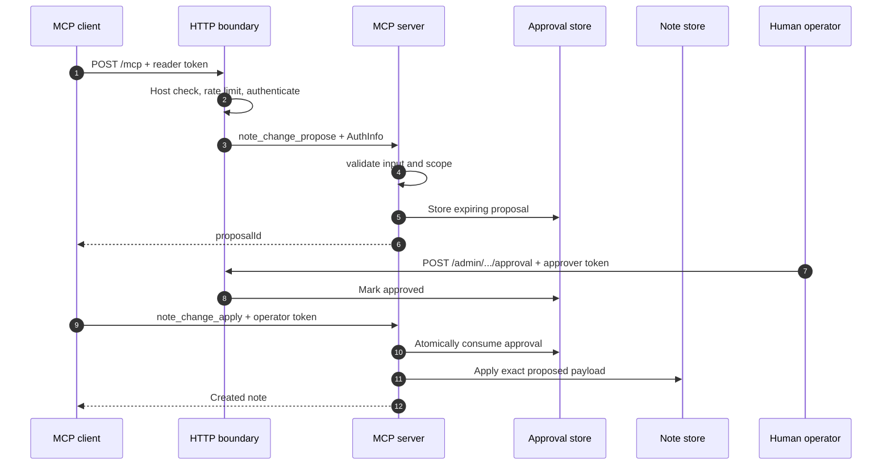
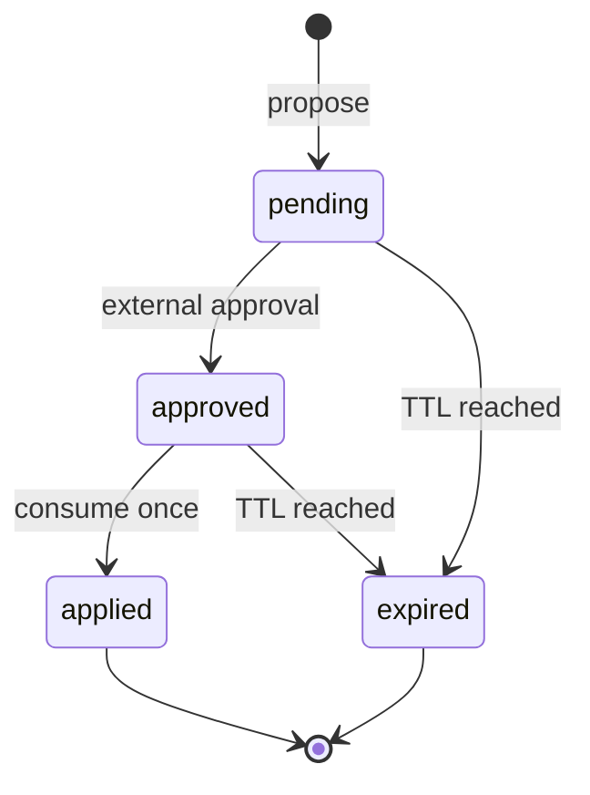

# Architecture

## Design goals

The starter optimizes for inspectability, least privilege, and safe extension. It keeps
the sample domain intentionally small so reviewers can trace one operation across all
trust boundaries.

## Request path

## Trust boundaries

1. **Network boundary:** Host validation, loopback binding, body parsing, and rate
   limiting run before MCP request handling.
2. **Identity boundary:** A credential maps to a server-controlled principal and scope
   set. The client cannot submit its own scopes.
3. **Tool boundary:** Every handler checks its own required scope. Route-level
   authentication is not treated as authorization.
4. **Approval boundary:** The MCP surface contains no approval tool. Approval requires a
   separate credential and route.
5. **Persistence boundary:** Stores own lifecycle rules, including expiration and
   single-use transitions.

## State model

The sample uses in-memory state, which is suitable only for local development and
single-process demonstrations. Production persistence should enforce the transition
from `approved` to `applied` in a transaction or conditional write.

## Why stateless HTTP

A fresh MCP server and transport are created per HTTP request. This avoids in-process
session affinity and makes horizontal scaling easier. The tradeoff is that
server-initiated streaming and resumability are intentionally absent from this starter.

Use stateful sessions only when the product requires those capabilities, then document
session ownership, expiration, distributed routing, and recovery.

## Dependency direction

Domain stores and security helpers do not import Express or MCP transport code. This
makes their state transitions independently testable and allows the transport or
persistence layer to be replaced without rewriting policy.
